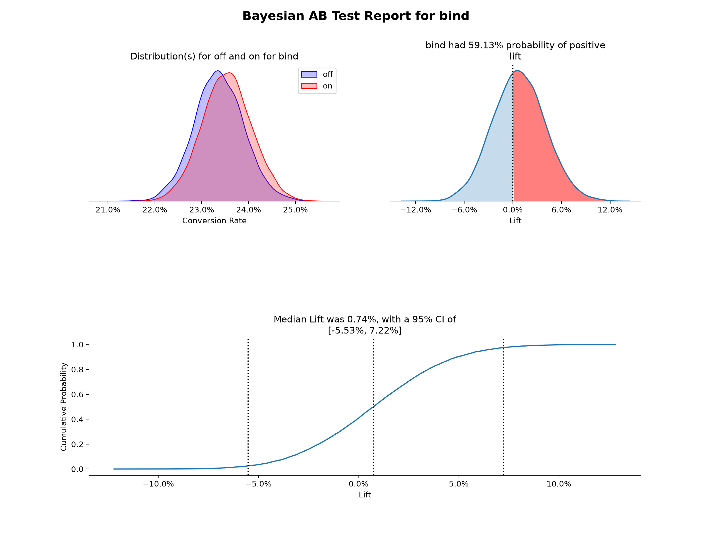
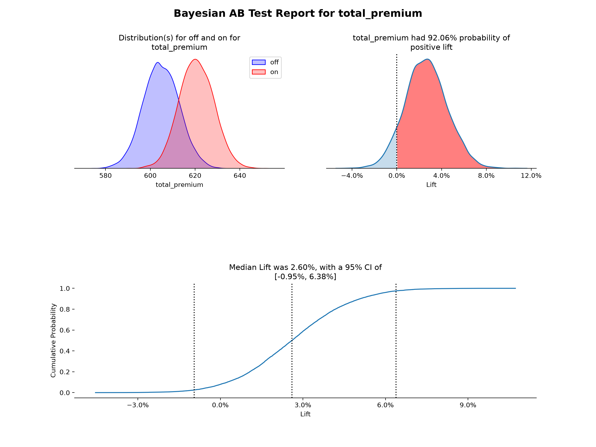
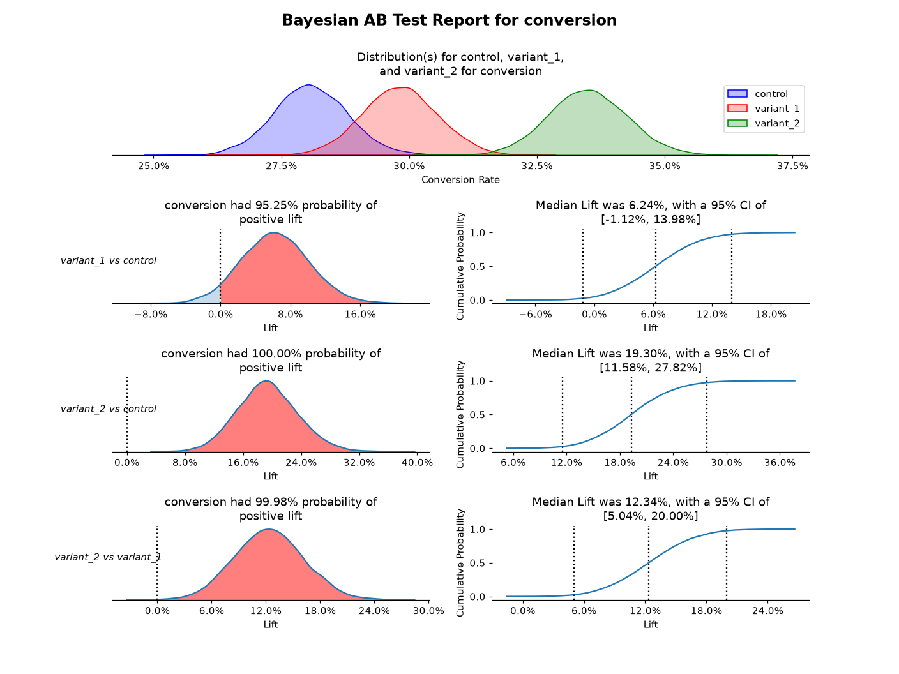
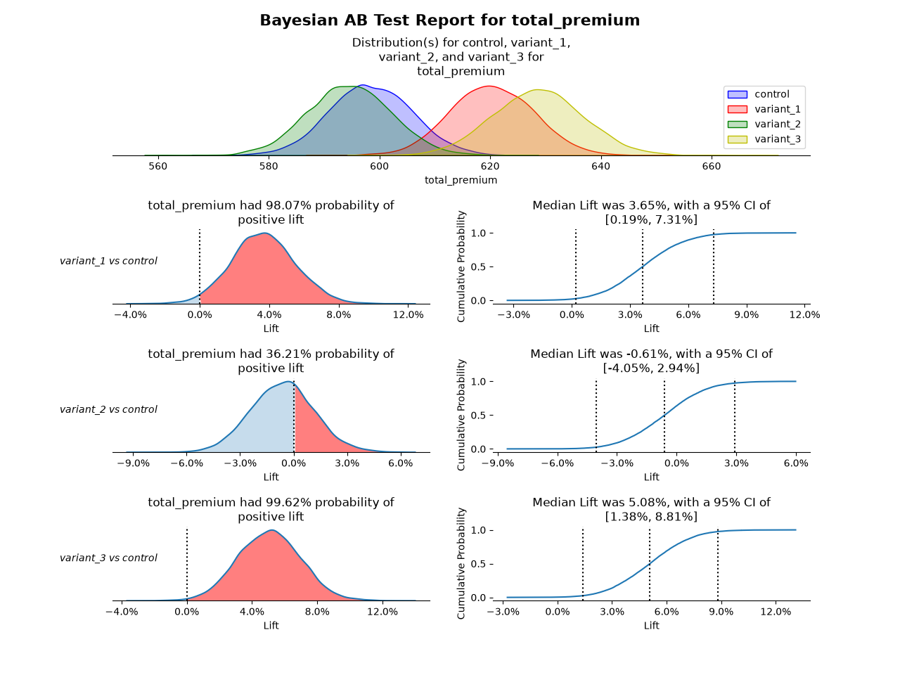
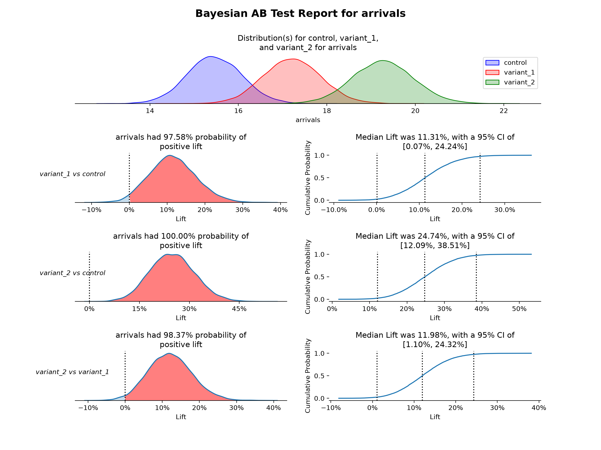

# Class ABTest

Configure a test with `ABTest(...)`, then call `fit(data)` to get a `Result` holding the posterior samples, lift, loss and plots.

```python
import pandas as pd
from matplotlib import pyplot as plt
from BayesABTest import ABTest, priors

df = pd.read_csv('some_file.csv')

test = ABTest('conversion', 'beta', control='off', random_state=0)
result = test.fit(df)

result.prob_better('on')            # probability the lift over control is positive
result.credible_interval('on')      # 95% interval of the lift
result.summary()                    # one row per bucket, as a DataFrame
result.plot()
plt.show()
```

## `ABTest(metric, family, *, control='off', group='bucket', prior=Empirical(), n_samples=10000, random_state=None)`

* `metric` - column name in the data for the response variable
* `family` - the distribution of the response variable:
  * `'beta'` - use for conversion rates. Binary 0/1 data
  * `'log-normal'` - use for continuous, greater than zero response variables (ex: premium, minutes spent on scene, etc.)
  * `'normal'` - use for continuous response variables on the interval (-inf, +inf)
  * `'poisson'` - use for discrete, greater than zero response variables (ex: arrivals per day, events per account, etc.)
* `control` - value in the `group` column for the control bucket (defaults to `'off'`)
* `group` - column name in the data for the bucket (defaults to `'bucket'`)
* `prior` - the prior belief about the response, from `BayesABTest.priors` (defaults to `Empirical()`):
  * `Uninformed()` - no prior belief about the response. Not available for `poisson`
  * `Empirical(scale=4)` - uses the control data as the prior, weakened by `scale`. For `beta` the control counts are divided by `scale`; for the other families the control variance is multiplied by `scale`
  * a fully specified prior, which must match the family:
    * `Beta(alpha, beta)` for `beta`
    * `Gamma(alpha, beta)` (beta is the rate) or `Gamma.from_mean_var(mean, var)` for `poisson`
    * `Normal(mean, var)` for `normal`
    * `LogNormal(mean, var)` for `log-normal`. `mean` and `var` are on the log scale
* `n_samples` - posterior samples drawn per bucket, at least 1,000 (defaults to 10,000)
* `random_state` - an int seed or `numpy.random.Generator`, for reproducible samples

## Methods

* `fit(data)` - fit to a pandas DataFrame (needs the `metric` and `group` columns). Returns a `Result`. The input is not modified.
* `fit_counts(successes, trials)` - `beta` family only. Fit from aggregated counts: two dicts of bucket name to number of conversions and number bucketed.

## Result

Returned by `fit()`. Any pair of buckets can be compared, not only variant against control.

### Attributes

* `metric`, `family`, `control`, `variants` - the configuration, with `variants` the list of non-control buckets
* `prior` - the concrete prior that was used (an `Empirical()` is resolved to a `Beta`, `Gamma`, etc.)
* `posteriors` - dict of bucket name to `Posterior(name, family, params)`. `params` is `alpha`/`beta` for `beta` and `poisson`, and `mean`/`var` of the mean for `normal` and `log-normal`
* `samples` - DataFrame of posterior samples, one column per bucket

### Methods

* `lift(numerator, denominator=None)` - array of `numerator / denominator - 1` for each sample. The denominator defaults to the control
* `prob_better(numerator, denominator=None)` - probability that the lift is positive
* `credible_interval(numerator, denominator=None, level=0.95)` - central interval `(low, high)` of the lift
* `ecdf(numerator, denominator=None)` - arrays `(x, y)` of the empirical CDF of the lift
* `summary(level=0.95)` - DataFrame with the posterior mean and credible interval of each bucket, and for each variant the median lift and probability of positive lift
* `loss(variant, *, loss_type='absolute', epsilon=0.0001)` - `beta` family only. Returns a `LossResult` with `risk_control`, `risk_variant`, `stop` and `winner`. `stop` is `True` once the risk of choosing one side is at or below `epsilon`. `print(result)` gives a readable summary.
  * `'absolute'` is the expected loss in conversion rate, E[max(other - chosen, 0)]
  * `'percent'` is the expected loss in lift terms, E[max(other - chosen, 0) / chosen]
* `plot(*, lift=True, compare_variants=False, ci=0.95)` - the full report. Returns the `Figure`. `compare_variants` also compares variants to each other. Lift charts are turned off (with a warning) for more than 5 variants, or more than 3 when comparing variants
* `plot_posteriors(variants=None, *, ax=None)`, `plot_lift(numerator, denominator=None, *, ax=None)`, `plot_ecdf(numerator, denominator=None, *, ci=0.95, ax=None)` - individual charts. Each draws on `ax` (default the current Axes) and returns the `Axes`

Nothing is printed. Warnings use the standard `warnings` module.

## Example output

The output of the `plot()` method is a uniform reporting style.

For a single variant AB test: starting in the top left and going clockwise:

* **Posterior Distributions** - Shows both variants posterior distributions, an estimate of the true conversion rate or continuous value, based on the prior and the observed data (using kernel density estimation plots)
* **Lift PDF** - Shows the probability density distribution of lift for the variant over the control, an estimate of the chance of improvement of the variant over the control (using kernel density estimation plot). Calculated by: the results from the sampled values for the variant percent change from the control. The proportion greater than 0 is highlighted.
* **Empirical CDF of Lift** - Uses the same lift vector, but is the empirical cumulative distribution function. Median lift is highlighted and labeled, as well as the chosen confidence interval.

### Conversion Rate Example (Beta Distribution)



### Continuous (Positive) Variable Example (Log-Normal Distribution)



For a multiple variant AB test:

* At the top: **Posterior Distributions** - Shows all variants posterior distributions, an estimate of the true conversion rate or continuous value, based on the prior and the observed data (using kernel density estimation plots)

Each row will then follow:

* Left: **Lift PDF** - Shows the probability density distribution of lift for a variant over the control, an estimate of the chance of improvement of the variant over the control (using kernel density estimation plot). Calculated by: the results from the sampled values for the variant percent change from the control. The proportion greater than 0 is highlighted.
* Right: **Empirical CDF of Lift** - Uses the same lift vector, but is the empirical cumulative distribution function. Median lift is highlighted and labeled, as well as the chosen confidence interval.

### Two Variant Conversion with Compare Variants



### Three Variant Continuous without Comparing Variants



### Two Variant Poisson with Comparing Variants


